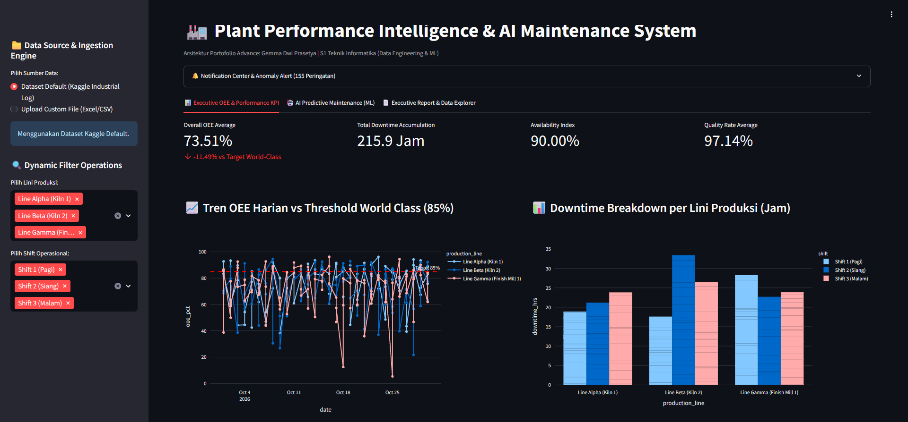
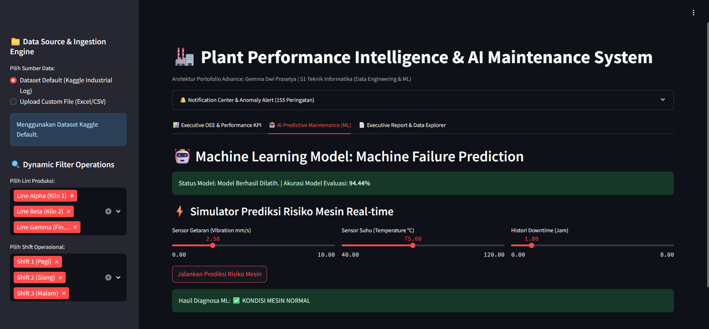

# 🏭 Plant Performance Intelligence & AI Maintenance System

[](https://python.org)
[](https://streamlit.io)
[](https://scikit-learn.org)
[](https://docker.com)

**Live Demo:** [https://hris.103.197.189.156.nip.io/analytics/](https://hris.103.197.189.156.nip.io/analytics/)

---

## 📌 Ringkasan

Sistem ini mengotomatisasi pengolahan data kinerja operasional pabrik (**ETL**), menghitung dan memvisualisasikan **Overall Equipment Effectiveness (OEE)**, serta memprediksi risiko kerusakan mesin dari data sensor (**Predictive Maintenance**) dengan Machine Learning. Semuanya disajikan dalam satu dashboard Streamlit interaktif.

## 📸 Tampilan Aplikasi

**Executive OEE & Performance KPI**



**AI Predictive Maintenance — simulator risiko mesin**



---

## ✨ Fitur Utama

- **Multi-source ingestion** — pakai dataset default atau upload file sendiri (`.csv` / `.xlsx`).
- **Perhitungan KPI otomatis** — Availability, Performance, Quality Rate, dan Overall OEE.
- **Dashboard eksekutif** — tren OEE harian terhadap target world-class 85% dan breakdown downtime per lini dan shift.
- **Predictive Maintenance** — Random Forest Classifier memprediksi risiko kerusakan dari getaran, suhu, dan histori downtime, lengkap dengan simulator real-time.
- **Alert otomatis** — peringatan untuk setiap baris data dengan OEE di bawah 80%.
- **Validasi data** — baris tidak valid (kosong, non-numerik, `planned_time`/`target` ≤ 0, nilai negatif) dibuang dan sensor dengan nilai mustahil dikosongkan, disertai peringatan di sidebar. Baris yang lolos tetapi tidak konsisten (downtime melebihi jadwal produksi, atau defect melebihi produksi) ditandai di kolom `data_anomaly` dan bisa dikecualikan dari KPI, alert, dan grafik lewat checkbox di sidebar.
- **Filter dinamis** — saring berdasarkan lini produksi dan shift.
- **Laporan eksekutif** — unduh Excel multi-sheet atau CSV hasil transformasi.

---


## 🔄 Cara Kerja

### 1. ETL (`src/etl_pipeline.py`)
Membaca CSV/Excel, memvalidasi kolom wajib, lalu menghitung:

| Metrik | Rumus |
|---|---|
| Operating time | `planned_time_hrs − downtime_hrs` |
| Availability | `operating_time / planned_time × 100` |
| Performance | `produced_units / target_units × 100` |
| Quality | `(produced_units − defect_units) / produced_units × 100` |
| **OEE** | `Availability × Performance × Quality` |

### 2. Predictive Maintenance (`src/ml_engine.py`)
- Model: `RandomForestClassifier` (100 pohon, `random_state=42`)
- Fitur: `vibration_mm_s`, `temperature_celsius`, `downtime_hrs`
- Target: `failure_risk` (0 = normal, 1 = risiko breakdown tinggi)
- Evaluasi: *stratified 5-fold cross-validation* yang diulang 5x dengan seed berbeda, hasilnya dirata-rata. Kelas risiko hanya ±3% dari data (9 dari 270 baris), sehingga satu split train/test berisi hanya ~3 kasus positif dan hasilnya tidak stabil.
- Ukuran utama: **recall** (kerusakan yang tertangkap), precision, dan F1. Akurasi tidak dipakai sebagai ukuran utama karena model yang selalu menjawab "normal" pun sudah mendapat ±96,7%.
- Threshold keputusan 0,3 (bukan 0,5): kerusakan yang terlewat lebih mahal daripada alarm palsu. Model final dilatih pada seluruh data (bukan data terfilter) dan di-cache.

---

## 📊 Contoh Hasil (dataset default)

| Indikator | Nilai |
|---|---|
| Rata-rata OEE | **73,51%** (11,49 poin di bawah target 85%) |
| Total downtime | 215,9 jam |
| Availability | 90,00% |
| Quality rate | 97,14% |
| Alert OEE < 80% | 155 peringatan |
| Recall model ML (CV) | **±100%** (9 dari 9 kasus risiko) |
| Precision / F1 (CV) | ±85% / ±91% |
| Alarm palsu | ±1,8 dari 260 baris normal |

> Catatan: metrik ML dihitung dari hanya 9 kasus risiko tinggi, jadi anggap sebagai perkiraan kasar, bukan jaminan performa di data baru.

Dataset default berisi 270 baris: 3 lini produksi (Alpha/Kiln 1, Beta/Kiln 2, Gamma/Finish Mill 1) × 3 shift × data harian.

---

## 🗂️ Struktur Proyek

```
plant-intelligence-system/
├── app.py                          # Dashboard Streamlit (3 tab)
├── src/
│   ├── etl_pipeline.py             # Ingestion, KPI/OEE, alert, export Excel
│   └── ml_engine.py                # Model Predictive Maintenance
├── tests/
│   └── test_pipeline.py            # Unit test ETL dan model ML
├── data/
│   └── plant_performance_advance_kaggle.csv
├── Dockerfile
├── docker-compose.yml
└── requirements.txt
```

## 📁 Format Data

File yang diupload **wajib** memiliki kolom berikut:

`planned_time_hrs`, `downtime_hrs`, `target_units`, `produced_units`, `defect_units`

Kolom opsional yang membuka fitur tambahan:

| Kolom | Fungsi |
|---|---|
| `date`, `production_line`, `shift` | Tren harian, filter, dan breakdown downtime |
| `vibration_mm_s`, `temperature_celsius`, `failure_risk` | Aktivasi tab AI Predictive Maintenance |

---

## 🚀 Menjalankan Proyek

### Lokal

```bash
git clone https://github.com/username_kamu/plant-intelligence-system.git
cd plant-intelligence-system

python -m venv venv
source venv/bin/activate        # Windows: venv\Scripts\activate
pip install -r requirements.txt

streamlit run app.py
```

Buka `http://localhost:8501`.

### Menjalankan Tes

```bash
python -m unittest discover -s tests -v
```

### Docker

```bash
docker compose up -d --build
```

Aplikasi berjalan di `http://localhost:8501`.

---

## 🛠️ Tech Stack

- **Core:** Python 3.10, Pandas, NumPy, scikit-learn
- **Visualisasi & UI:** Streamlit, Plotly Express
- **Reporting:** openpyxl
- **DevOps:** Docker, Docker Compose

---

## 👤 Developer

**Gemma Dwi Prasetya**
S1 Teknik Informatika — Universitas Negeri Surabaya
Backend Developer & Data Engineer
